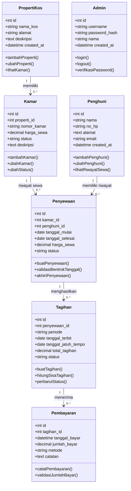

# KosManage

Manage Your Property, Simplify Your Business.

Aplikasi web untuk mengelola properti kos: kamar, penghuni, penyewaan, tagihan, pembayaran, dan laporan.

## Class Diagram

Diagram kelas KosManage berikut menggambarkan struktur kelas, atribut, operasi, serta hubungan antar kelas. Diagram ditulis menggunakan Mermaid agar dapat ditampilkan langsung oleh GitHub.

**File diagram sumber:** [KosManage_ClassDiagram.drawio](KosManage_ClassDiagram.drawio) — dapat dibuka dan diedit menggunakan [diagrams.net](https://app.diagrams.net/).
