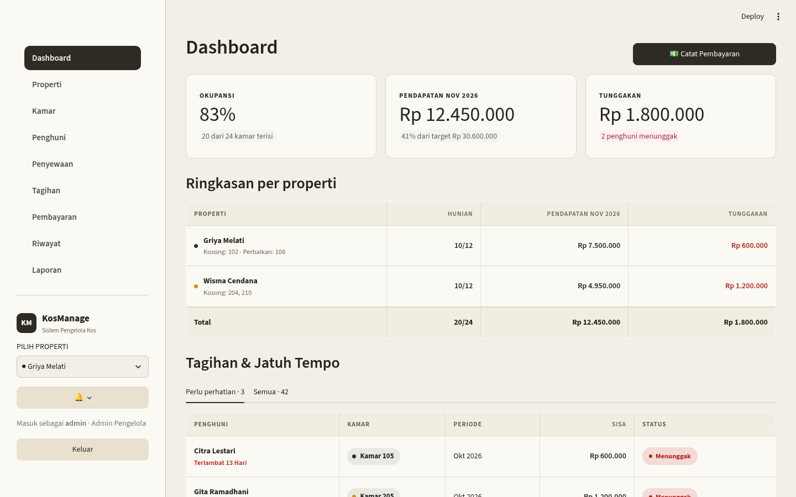
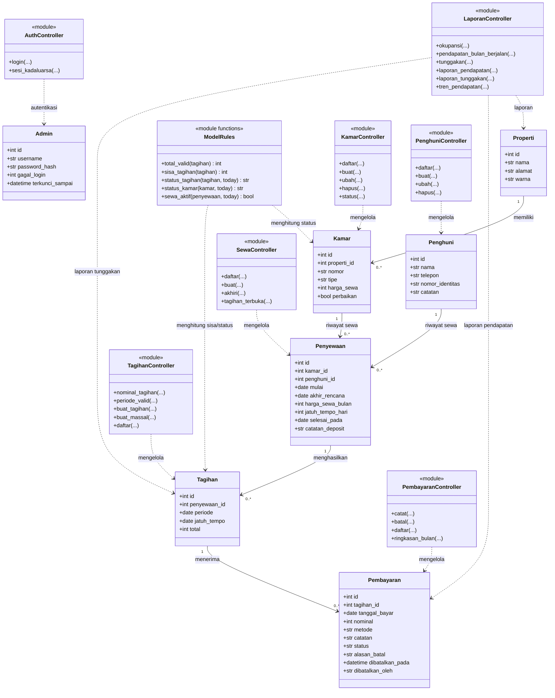

# KosManage Sistem Pengelola Dua Properti Kos

Source aplikasi admin KosManage sesuai **PRD v1.1** (Python · Streamlit · SQLAlchemy · SQLite · MVC · zona waktu Asia/Jakarta) dan **Design System v2.4** (konten primer dulu: maksimal 3 kartu · 2 tabel · 6 kolom · 1 tombol primer per halaman; banner dihapus → toast + lonceng; detail per baris via dialog).

## Menjalankan

```bash
pip install -r requirements.txt
streamlit run app.py
```

Login default: **admin / kosmanage123** — ganti lewat environment variable sebelum dipakai serius:

```bash
export KOSMANAGE_ADMIN_USER=admin
export KOSMANAGE_ADMIN_PASS="password-minimal-8-karakter"
```

## Screenshot Aplikasi

### Dashboard



## Class Diagram

Diagram berikut menggambarkan model data SQLAlchemy pada `database/models.py` beserta modul controller yang menjalankan aturan bisnis. Kotak controller diberi stereotipe `<<module>>` karena implementasinya berupa modul fungsi, bukan class Python.



**Keterangan relasi:**
- Satu `Properti` memiliki banyak `Kamar`; setiap kamar berada pada satu properti.
- `Kamar` dan `Penghuni` masing-masing dapat memiliki banyak riwayat `Penyewaan`.
- Satu `Penyewaan` dapat menghasilkan beberapa `Tagihan`, dan satu tagihan dapat menerima beberapa `Pembayaran`.
- `harga_sewa_bulan` disimpan pada `Penyewaan` sebagai salinan harga ketika sewa dibuat.
- Status kamar dan status tagihan dihitung melalui fungsi aturan domain, bukan disimpan sebagai atribut tersendiri.

## Uji

```bash
python -m tests.test_rules
```

## Backup & pemulihan (FR-18)

Backup harian otomatis ke `backups/` saat aplikasi start (retensi 30 hari). Pulihkan:

```bash
python -m database.restore backups/kosmanage-2026-11-17.db
```

## Catatan implementasi

- **Uang** disimpan sebagai integer rupiah tanpa desimal (integritas data PRD).
- **Tidak ada hapus permanen** pada penyewaan/tagihan/pembayaran; koreksi = pembatalan beralasan (BR-19). Kamar/penghuni hanya bisa dihapus jika belum punya penyewaan.
- **Status kamar** dihitung dari penyewaan aktif, kecuali ditandai Perbaikan (FR-06, BR-21).
- **Prorata** bulan pertama/terakhir harian, dibulatkan ke rupiah (BR-14); jatuh tempo per sewa tanggal 1–28 (BR-09).
- **Pembayaran berlebih ditolak** dengan pesan menyebut sisa tagihan (BR-16); klik ganda tervalidasi ulang karena sisa berkurang sebelum commit.
- **CSV** diekspor dengan format rupiah/tanggal yang sama seperti tampilan (FR-17).
- **Grafik tren** hanya di halaman Laporan dengan dua warna properti tetap (espresso/kuning tua); jika plotly tidak tersedia, dipakai grafik CSS cadangan dengan palet yang sama.
- Angka pada meta di bawah judul halaman selalu dihitung dari database, bukan teks tetap.
